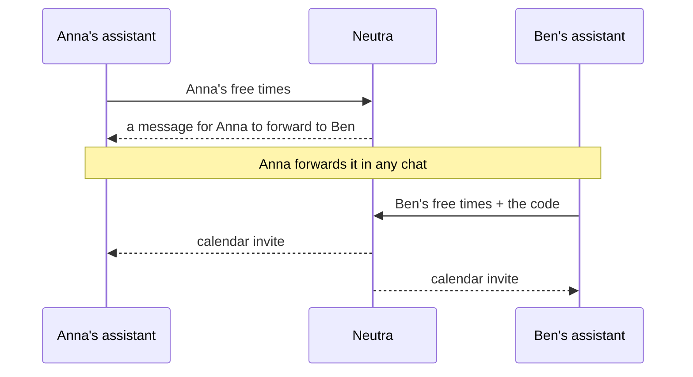

# Neutra

A neutral place where people's AI assistants agree on things for them, without anyone seeing anyone else's data.

Today it does one thing: two people's assistants find a time to meet. Each assistant tells Neutra when its person is free. Neutra finds a common time and sends one calendar invite to both. Neither side ever sees the other's times.

It works across assistants: Anna can use Claude and Ben another assistant, as long as both support MCP connectors. Ben can also answer without an assistant: the message includes a link to a simple page where he signs in with Google and adds the times he's free.

## Privacy, by design

- **No AI on Neutra's side.** Neutra is plain code that compares time ranges. Your times never go into an AI model of ours.
- **Nobody sees anyone's times.** Only the matched meeting time comes back. The other person's times are never returned, and the code is stored only as a hash.
- **Times are deleted** as soon as a decision is settled, at the latest after 14 days. The person answering never has their times stored at all.
- **Retries can't map a calendar.** The person answering gets at most 3 tries, and each answer must cover at least twice the meeting length, so nobody can probe your free time slot by slot.
- **Data stays in the EU**, in Cloudflare's EU jurisdiction.
- **Checked by tests:** [`test/decisions.test.ts`](test/decisions.test.ts) verifies that no times or codes appear in any response.

Details: [privacy page](https://neutra.day/privacy).

## Try it

1. In Claude: open [Neutra in the connector directory](https://claude.ai/directory/connectors/neutra) and **Connect**. Other assistants: add `https://neutra.day/mcp` as a custom connector.
2. Sign in with Google. Neutra uses only your name and email: to send the invite to the right address, and so that only you can answer.
3. Ask: *"Use Neutra to find an hour with Ben next week. I'm free Tuesday and Thursday, 18:00–21:00."* Forward the message it gives you.

## For agent builders

A remote MCP server with Google sign-in. Resources follow [Google's AIPs](https://google.aip.dev): `decisions/{decision}` and `decisions/{decision}/answers/{answer}`.

| Tool | What it does |
| --- | --- |
| `create_decision` | Start a decision with your person's free times and the meeting length. Returns a code and a message to forward. |
| `create_answer` | Answer with the code from the message (`neutra:<id>.<code>`) and your person's free times. A match sends the invite. |
| `get_decision` | Status (`WAITING`, `NO_MATCH`, `INVITE_SENT`, `ACCEPTED`, `DECLINED`, `EXPIRED`) and the meeting time. |
| `delete_decision` | Cancel a decision you started, including its invite. |
| `get_answer` | Read your own answer. |
| `create_feature_request` | Tell Neutra's makers about something your person wanted that Neutra can't do yet. |
| `get_feature_request` | Read a feature request you sent. |

### Price decisions (off by default)

Two people agree on a price (rent, a sale, a fee) without either seeing the other's limit. A price decision is a kind of decision: the starter's assistant calls `create_decision` with `decision.price` (subject, details, `currencyCode`, unit, `answerBy`) and `starterAnswer.price` with one number: `minimumToAccept` if they receive the money, or `maximumToPay` if they pay. The other side answers with `create_answer` and `answer.price`, always in the decision's currency. If the payer's maximum reaches the receiver's minimum, there is a deal; otherwise both hear only "no deal". Both get the result by email.

`decision.price.rule` says where in the overlap a deal lands, and so what it reveals:

| Rule | Price | What a deal reveals |
| --- | --- | --- |
| `MIDPOINT` (default) | the middle of where the numbers meet | each side can work out the other's number |
| `LOWEST` | the receiver's minimum | the payer learns it; the payer's number stays private |
| `HIGHEST` | the payer's maximum | the receiver learns it; the receiver's number stays private |
| `MIDPOINT_ROUNDED` | the middle, rounded to `roundTo` (default about 1% of the starter's number), kept inside the overlap | each side's number only roughly |
| `RANDOM` | a uniform random point in the overlap | only that the other's number is beyond the price |
| `OVERLAP_ONLY` | none: the result is only "your numbers overlap" or "don't overlap" (salaries, early screening) | nothing: neither number shows |

`decision.price.maxAnswers` (1 to 3, default 1) is how many numbers the other side may send. After a no-deal with answers left the request stays open for them; the starter sees nothing of failed tries. The person answering is told the rule in plain words (`ruleText`) and their number of answers before answering: in the hand-off message, the preview and the web page.

- The answering person's number is never stored, not even between tries. The starter's is encrypted with a key made from the request code (stored only as a hash) and cleared as soon as the request settles or ends.
- `get_decision` with a `code` returns a `preview` of what a request asks for before answering (`yourSide` `PAYS`: send `maximumToPay`; `RECEIVES`: send `minimumToAccept`), without using it up.
- Inputs and outputs follow the `neutra.v1` messages (proto3 JSON): every price field sits inside `price`, e.g. `decision.price.agreedPriceText`.
- A limit may also be a range, e.g. `"10000-20000"` (a pay band with a floor, a price with a ceiling). Both ends count: a deal needs the two sides' ranges to meet, and the rule picks the price inside where they meet. A single number leaves the far end open. An inner end can only work against its own side, so there is nothing to gain by exaggerating it. Both ends of the starter's range are sealed; the answering person's are never stored.
- `validateOnly` on either call reads the number back for the person to confirm, without sending anything.
- At most 3 price requests answered per person per day (all tries of one request count once).
- Switched by `PRICE_DECISIONS` in `wrangler.jsonc`: `off` (nothing changes for anyone), `testers` (only `ALLOWED_EMAILS` get `decision.price` in `create_decision`; anyone with a code can answer) or `open`. See `docs/RUNBOOK.md`.

Errors use `google.rpc` codes: `NOT_FOUND`, `PERMISSION_DENIED`, `FAILED_PRECONDITION`, `INVALID_ARGUMENT`, `RESOURCE_EXHAUSTED` (a daily or hourly limit was reached).

## Running Neutra

Runs on Cloudflare Workers with D1, based on Cloudflare's `remote-mcp-google-oauth` template. Every push to `main` is type-checked, tested and deployed by GitHub Actions (`.github/workflows/deploy.yml`); migrations in `migrations/` are applied before each deploy. Changes go through pull requests.

### Setup (done once)

**Cloudflare**
- Account ID and the `MCP_RESOURCE` address are in `wrangler.jsonc`. The domain `neutra.day` is attached to the Worker as a Custom Domain in the Cloudflare dashboard.
- API token: "Edit Cloudflare Workers" template plus **D1: Edit**.
- The D1 database (EU jurisdiction) and the `OAUTH_KV` namespace were created once with `wrangler d1 create neutra --jurisdiction eu` and `wrangler kv namespace create OAUTH_KV`; their IDs are in `wrangler.jsonc`.

**Google Cloud** (project `neutra`)
- Google Auth Platform: audience External, publishing status **In production** (testing mode makes refresh tokens expire after 7 days). Branding: home page and privacy links above, authorized domain `neutra.day`.
- Web client with redirect URI `https://neutra.day/callback`, used by both the connector sign-in and the browser answer page (add `https://developers.google.com/oauthplayground` only while making a new inviter key, and `http://localhost:8788/callback` for local dev).
- Google Calendar API and Gmail API enabled.
- Sign-in asks only for email and profile. While `ACCESS_MODE` is `allowlist`, only `ALLOWED_EMAILS` can sign in.

**Inviter** (`neutra.invites@gmail.com`)
- Refresh token with scopes `calendar.events` and `gmail.send`, obtained via the OAuth 2.0 Playground using the web client's own credentials (steps in `docs/RUNBOOK.md`).

**GitHub secrets** (Settings → Secrets and variables → Actions)

| Secret | What |
| --- | --- |
| `CLOUDFLARE_API_TOKEN` | Cloudflare API token |
| `GOOGLE_CLIENT_ID`, `GOOGLE_CLIENT_SECRET` | Web client |
| `COOKIE_ENCRYPTION_KEY` | Any long random string |
| `ALLOWED_EMAILS` | Comma-separated emails of the test users |
| `INVITER_REFRESH_TOKEN` | Inviter's refresh token |

### Local development

`npm install`, copy `.dev.vars.example` to `.dev.vars` and fill it in, then `npm run dev`. Test with `npx @modelcontextprotocol/inspector@latest` against `http://localhost:8788/mcp`.

## License

MIT, see [LICENSE](LICENSE). Includes code from Cloudflare's MIT-licensed templates.
